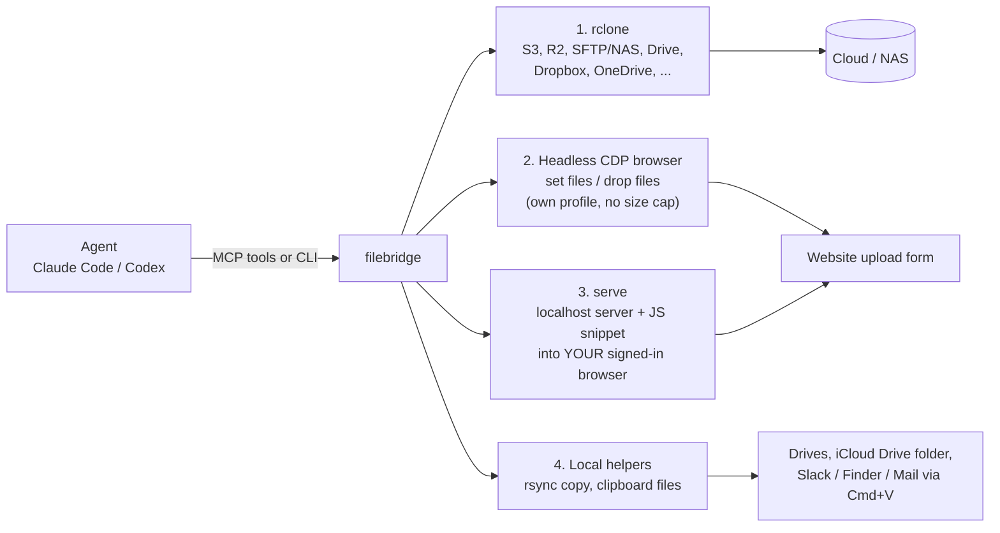

# filebridge

**Move files of any size anywhere, from an AI agent: an MCP server and CLI for Claude Code, Codex and friends.**

[](LICENSE)
[](pyproject.toml)
[](https://modelcontextprotocol.io)

## Why

"Upload this video to my Drive" fails for agents in three boring ways:

- **Native file pickers cannot be driven.** There is nothing to click, and dragging from Finder is impossible.
- **Browser-extension uploads are capped at about 10 MB.** The file is pushed through the extension, not read from disk.
- **Headless browsers have no logins.** A fresh automation browser is signed out of everything.

filebridge gives the agent four paths around that. Each one hands real disk paths to something that reads the file
itself, so there is no size cap.



Which path to use:

| You want to... | Use |
|---|---|
| Put files on a store that has an rclone backend (S3/R2, SFTP/NAS, Dropbox, ...) | `transfer` (needs a configured remote) |
| Upload to a website that needs no login, or one you signed into in the automation profile | `browser_set_files` / `browser_drop_files` / `browser_click(files=...)` |
| Upload to a website where you are already signed in, in your everyday browser | `filebridge serve` |
| Copy to a drive, NAS mount or iCloud Drive folder | `local_copy` |
| Paste files into a desktop app (Slack, Telegram, Mail, Finder) | `clipboard_files`, then Cmd+V |

## Install

Requires Python 3.12+. Optional: [rclone](https://rclone.org) for path 1, Brave or Chrome for paths 2 and 3.

```bash
# from a clone
git clone https://github.com/vincesector/filebridge && cd filebridge
uv tool install .

# or straight from git
uv tool install git+https://github.com/vincesector/filebridge
# pip install git+https://github.com/vincesector/filebridge
```

Check it works: `filebridge --help`.

Platform note: developed and tested on macOS. Browser discovery looks for Brave and Chrome in `/Applications`, and
`clipboard_files` / `reveal` use macOS pasteboard and Finder. rclone and `serve` have no macOS-specific code.

## Quickstart

### Claude Code

```bash
claude mcp add filebridge --scope user -- filebridge mcp
```

If `filebridge` is not on the PATH Claude Code sees, use the absolute path from `which filebridge`.

### Codex

In `~/.codex/config.toml`:

```toml
[mcp_servers.filebridge]
command = "filebridge"
args = ["mcp"]
```

### First upload

Ask the agent to upload a file, or run it yourself:

```bash
filebridge browser launch --url https://example.com/upload     # headless
filebridge browser tabs
filebridge set-files --tab example.com --selector 'input[type=file]' ~/big.zip
filebridge browser wait --tab example.com "Upload complete"
```

For a site that needs a login, sign in once in the automation profile (a visible window, you do the login), then go
back to headless:

```bash
filebridge browser launch --visible --url https://the-site.example
# log in, then:
filebridge browser launch            # headless again, same saved session
```

Or skip the automation profile and use the browser you are already signed in with:

```bash
filebridge serve --json ~/path/video.mp4 [more files] [--selector 'input[type=file]']
```

`serve` prints a JavaScript snippet. Run it in the signed-in tab (for example with a browser extension's JavaScript
tool). The page fetches the files from `127.0.0.1` and either fills the matching `<input type=file>` or drops the files
on the page's upload zone. The server stops once every file was fetched, or after `--ttl` seconds.

## How the browser paths work

- `browser_set_files` uses CDP `DOM.setFileInputFiles`, so the browser reads the file from disk. It searches the page,
  open and closed shadow roots, and same-origin and cross-site iframes. Hidden inputs work. With no selector it acts
  only if exactly one file input exists; otherwise it returns the candidates.
- `browser_drop_files` sends real `Input.dispatchDragEvent` events carrying disk paths. If the page receives no files it
  falls back to an in-page `DataTransfer` built from disk-backed File objects (still no size cap, but the events are
  synthetic, `isTrusted=false`). The result says which method ran.
- `browser_click(..., files=[...])` always intercepts file choosers, so a native picker never appears. Use it for
  "Upload file" menu items that create the input on click.
- `tab` is a tab id or a unique part of its URL or title.
- Because the browser is headless, `browser_text` and `browser_screenshot` are how you see the page.

## CLI reference

Add `--json` to any command for machine-readable output. Exit code 1 on failure. Long jobs return a job id; add
`--wait` to block until done.

| Command | What it does |
|---|---|
| `filebridge mcp` | Run the MCP server on stdio (what Claude Code / Codex launch) |
| `filebridge remotes` | List configured rclone remotes |
| `filebridge transfer SRC DEST [--mode copy\|move\|sync] [--dry-run] [--overwrite] [--confirm] [--bwlimit 10M] [--wait]` | Copy/move/sync between local paths and rclone remotes as a background job |
| `filebridge status JOB` | Progress of a background job |
| `filebridge jobs [--limit N]` | Recent background jobs |
| `filebridge cancel JOB` | Stop a running job |
| `filebridge ls PATH [-r] [--max N]` | List a remote or local path |
| `filebridge link PATH` | Shareable link for a remote file or folder |
| `filebridge mkdir PATH` | Create a remote folder |
| `filebridge stat PATH` | Does a remote path exist; size and type |
| `filebridge setup [BACKEND]` | Exact commands to add a remote (drive, dropbox, onedrive, icloud, s3, r2, sftp) |
| `filebridge copy SRC DEST [--overwrite] [--dry-run] [--wait]` | Local rsync copy as a background job |
| `filebridge clipboard PATH...` | Put files on the macOS pasteboard |
| `filebridge reveal PATH` | Show a path in Finder (opens a window) |
| `filebridge set-files --tab T [--selector S] PATH...` | Attach local files to a file input in the headless browser |
| `filebridge drop --tab T [--selector S] [--x X --y Y] [--method auto\|cdp\|synthetic] PATH...` | Drag-and-drop local files onto a drop zone |
| `filebridge serve [--selector S] [--port P] [--ttl SECONDS] PATH...` | Serve files to your own signed-in browser and print an upload snippet |
| `filebridge browser launch [--url U] [--browser auto\|brave\|chrome] [--visible]` | Start or reuse the automation browser (headless unless `--visible`) |
| `filebridge browser close` | Close it (profile and logins are kept) |
| `filebridge browser tabs` | List tabs |
| `filebridge browser navigate --tab T URL [--timeout S]` | Point a tab at a URL |
| `filebridge browser text --tab T [--selector S] [--max-chars N]` | Read the visible text of a page or element |
| `filebridge browser screenshot --tab T [--path P] [--full-page]` | Save a PNG of a tab |
| `filebridge browser click --tab T --selector S [--file F ...]` | Click an element; `--file` fills a file chooser it opens |
| `filebridge browser type --tab T --selector S TEXT [--clear] [--enter]` | Type into a field |
| `filebridge browser wait --tab T WHAT [--timeout S]` | Wait for a selector or text |

Paths must be absolute or start with `~`. Local sources under `~/.ssh`, `~/.gnupg`, `~/.aws`, `~/.config/rclone` and
`~/Library/Keychains` are refused.

## MCP tools

The MCP server and the CLI call the same code (`filebridge/core.py`). `serve` is CLI-only.

| Group | Tools |
|---|---|
| rclone | `remotes`, `transfer`, `job_status`, `jobs_list`, `cancel`, `ls`, `link`, `mkdir`, `stat`, `setup_instructions` |
| Browser | `browser_launch`, `browser_close`, `browser_tabs`, `browser_set_files`, `browser_drop_files`, `browser_click`, `browser_wait`, `browser_navigate`, `browser_text`, `browser_screenshot`, `browser_type` |
| Local | `local_copy`, `clipboard_files`, `reveal` |

Nothing here deletes anything. `move` removes the source only after rclone verified the copy. `sync` can delete on the
destination and requires a prior `dry_run` (or `confirm=true`). Copies skip existing files unless `overwrite=true`.

## Security notes

- **`serve` binds `127.0.0.1` only.** Every URL carries a random token, and the server stops once every file was
  fetched or the TTL (default 1800 s) runs out. It sends permissive CORS and Private Network Access headers so a page
  on another origin can fetch from it, which is why the token matters: do not paste the URLs or snippet anywhere you
  do not trust.
- **The automation browser uses a dedicated profile** (`~/.filebridge/browser-profile`) with DevTools on
  `127.0.0.1:9229` only. Never point it at your daily profile: Chrome 136+ ignores the debugging port on the default
  profile anyway, and giving an agent your everyday logins is a bad idea. Sign in to only the sites you need.
- **rclone remotes are configured by a human.** `setup_instructions` prints the command; filebridge never configures
  real accounts. Secrets stay in rclone's own config and are never printed.
- No `shell=True` anywhere; subprocesses take argument lists. Sensitive local source directories are refused.
- Job state is stored in `~/.filebridge/jobs/<id>.{json,log}` and `~/.filebridge/jobs.jsonl`.

## Limitations

- macOS first. Browser discovery only looks in `/Applications` for Brave and Chrome; `clipboard_files` and `reveal`
  need macOS.
- `browser_click` and `browser_drop_files` act on the main page and same-origin iframes, not cross-site iframes.
- Sites with bot detection may block headless Chrome-family browsers. CAPTCHAs and 2FA are the human's job (use the
  visible sign-in).
- `serve` fetches through the page, so the page's own Content Security Policy can block it, and the snippet has to be
  run in the tab by something that can execute JavaScript there.
- The `iclouddrive` rclone backend is fragile (Apple blocks some accounts; Advanced Data Protection must be off). To
  reach iCloud Drive, `local_copy` into its local folder is more reliable.
- No delete tool, by design.

## FAQ

**Why not just use the browser extension's upload tool?** It caps files at about 10 MB. `serve` exists for exactly
that case: your signed-in tab pulls the file from localhost, no extension cap involved.

**Does `set_files` really have no size limit?** The browser reads the file from disk itself. A 300 MB file went through
every browser path with a matching page-side SHA-256.

**Will a window pop up on my screen?** Not unless you pass `--visible` (or call `reveal`). The automation browser runs
`--headless=new`.

**Can I use it without MCP?** Yes, every action is a CLI command, so scripts and cron/launchd jobs can use it.

**Do I need rclone?** Only for `transfer`, `remotes`, `ls`, `link`, `mkdir`, `stat` and `setup_instructions`.

**Why not drive my normal browser over CDP?** See the security notes: dedicated profile only.

## Development

```bash
uv sync
.venv/bin/python tests/test4_mcp_listing.py     # tool list over stdio
.venv/bin/python tests/test_local.py            # rsync job, reveal validation
.venv/bin/python tests/test3_clipboard.py       # macOS pasteboard
```

Tests that need Brave/Chrome: `test2_browser.py` (300 MB through every browser path), `test5_cli_headless.py`,
`test6_browser_extras.py`. Needs rclone: `test1_transfer.py` (2 GiB through a local alias remote). Design notes are in
[docs/DESIGN.md](docs/DESIGN.md).

## License

[MIT](LICENSE)
