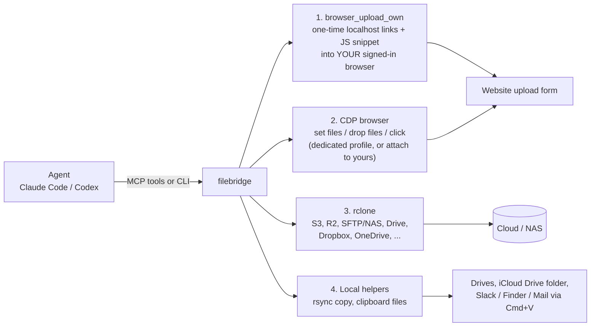

# filebridge

<!-- mcp-name: io.github.vincesector/filebridge -->

**Upload files larger than 10 MB from Claude Code, Codex or any AI agent into the browser you're already logged in to.**
`browser_upload_own` (CLI: `filebridge serve`) gives your signed-in tab a one-time localhost link and a JavaScript
snippet, and the page pulls the file from disk itself, so there is no size cap and nothing to sign in to again.

Use it when Claude in Chrome's `file_upload` is not available or stops at 10 MB, when you need to attach a local file to
an `<input type=file>` from an AI agent, or when a native file picker is in the way. The same MCP server and CLI also
drive a headless browser (set files, drop files, intercepted file choosers) and move files to S3, R2, a NAS, Dropbox and
the rest through rclone.

[](LICENSE)
[](pyproject.toml)
[](https://modelcontextprotocol.io)
[](https://filebridge.evinho.xyz)

```bash
claude mcp add filebridge --scope user -- uvx --from git+https://github.com/vincesector/filebridge filebridge mcp
```

## For AI agents

Paste this into your `CLAUDE.md` or `AGENTS.md` so the agent reaches for filebridge instead of the file picker:

```markdown
## File uploads: use filebridge
When a local file must be uploaded or attached to a website (Drive, X, Typefully, any form), do not use the native
file picker or the browser extension's file upload (about 10 MB cap). Use the filebridge MCP tools:
- Site the user is signed in to in their own browser: `browser_upload_own(paths=[...], verify_text="<file name>")`,
  then run the returned `snippet` in that tab with the browser extension's JavaScript tool, exactly as returned (it
  uses top-level await). It returns JSON `{ok, ...}`. Then run `verify_snippet` and check `serve_status(server_id)`.
  Each link works once: after `LinkUsed` or `FetchBlocked`, call `browser_upload_own` again.
- Automation browser or an attached Chrome/Brave: `browser_snapshot(tab)`, then `browser_set_files(ref=...)` for a
  file input, `browser_drop_files(ref=...)` for a drop zone, `browser_click(ref=..., files=[...])` for an upload button.
- Cloud or NAS with an rclone remote: `transfer(src, "remote:folder")`, then poll `job_status(job_id)`.
- `PathNotAllowed`: ask the user to approve, or to add the folder to `allowed_roots` in `~/.filebridge/config.toml`.
  `PathBlocked` means a credential file: never work around it.
```

Claude Code users can install the matching skill instead (it triggers on "upload/attach this file to <site>"):

```bash
mkdir -p ~/.claude/skills/upload-file-to-website
curl -fsSL https://raw.githubusercontent.com/vincesector/filebridge/main/skills/upload-file-to-website/SKILL.md \
  -o ~/.claude/skills/upload-file-to-website/SKILL.md
```

From a clone: `cp -r skills/upload-file-to-website ~/.claude/skills/`. A plain-text summary for LLMs is at
[llms.txt](llms.txt), and every tool is described in [llms-full.txt](llms-full.txt).

## Why

"Upload this video to my Drive" fails for agents in three boring ways:

- **Native file pickers cannot be driven.** There is nothing to click, and dragging from Finder is impossible.
- **Browser-extension uploads are capped at about 10 MB.** The file is pushed through the extension, not read from disk.
- **Headless browsers have no logins.** A fresh automation browser is signed out of everything.

filebridge gives the agent four paths around that. Each one hands real disk paths to something that reads the file
itself, so there is no size cap.



Which path to use:

| You want to... | Use |
|---|---|
| Upload to a site where you are already signed in, in your everyday browser | `browser_upload_own` (CLI: `filebridge serve`) |
| Upload to a site with no login, or one you signed into in the automation profile | `browser_snapshot`, then `browser_set_files` / `browser_drop_files` / `browser_click(files=...)` |
| Drive your own running Chrome/Brave over DevTools | `browser_launch(mode="attach")`, then the same tools |
| Put files on a store that has an rclone backend (S3/R2, SFTP/NAS, Dropbox, ...) | `transfer` (needs a configured remote) |
| Copy to a drive, NAS mount or iCloud Drive folder | `local_copy` |
| Paste files into a desktop app (Slack, Telegram, Mail, Finder) | `clipboard_files`, then Cmd+V |

## Install

Requires Python 3.12+ (uv installs one if needed). Optional: [rclone](https://rclone.org) for `transfer`, Brave or
Chrome for the browser tools.

Nothing to install up front: the MCP config below runs it with `uvx`. To try the CLI the same way:

```bash
uvx --from git+https://github.com/vincesector/filebridge filebridge --help
```

Or install it for good:

```bash
uv tool install git+https://github.com/vincesector/filebridge     # or: pip install git+https://github.com/vincesector/filebridge
filebridge --help
```

Platform note: developed and tested on macOS. Linux and Windows support (browser discovery on the PATH and in the
standard install folders, `xclip` / `wl-copy` and PowerShell `Set-Clipboard -Path` for the clipboard, `xdg-open` and
`explorer /select,` for reveal) is best effort and **untested**. rclone and `browser_upload_own` have no
platform-specific code.

## Quickstart

### Claude Code

```bash
claude mcp add filebridge --scope user -- uvx --from git+https://github.com/vincesector/filebridge filebridge mcp
```

Only need uploads? Add `--slim` after `mcp` to expose just the upload tools (`browser_upload_own`, `serve_status`,
`serve_stop`, `browser_set_files`, `browser_drop_files`, `browser_snapshot`, `browser_tabs`, `browser_navigate`,
`browser_launch`) and save context. With `uv tool install`, the command is just `filebridge mcp`.

### Codex

In `~/.codex/config.toml`:

```toml
[mcp_servers.filebridge]
command = "uvx"
args = ["--from", "git+https://github.com/vincesector/filebridge", "filebridge", "mcp"]
```

### First upload: your own signed-in browser

Ask the agent "upload ~/Movies/final.mp4 to my Drive". It calls `browser_upload_own(paths=[...])`, which starts a
server on `127.0.0.1` in the background and returns:

```json
{"ok": true, "server_id": "3f9c1a2b7d4e", "urls": ["http://127.0.0.1:53817/<token>/0/final.mp4"],
 "snippet": "var __fbUrls=[...]; ... JSON.stringify(__fbRes);", "expires_in_s": 1800}
```

The agent runs `snippet` in the signed-in tab with any tool that executes JavaScript there (for example the Claude in
Chrome extension's JavaScript tool). The page fetches each file from localhost, then fills the `<input type=file>`
matching `selector`, or drops the files on the element at the page centre when there is no selector (how Drive, X and
Typefully listen). The snippet's result is a JSON string: `{"ok": true, "action": "dropped", "files": 1, "bytes": ...}`
or `{"ok": false, "code": "FetchBlocked", "message": ...}`. `serve_status(server_id)` shows what was fetched.

Pass `verify_text` (for example the file name or "Upload complete") or `verify_selector` and the result also carries a
`verify_snippet`: run it after the upload snippet and it waits until the page shows that, returning `{verified, waited_s}`.

The same from the CLI (prints the URLs and snippet, exits once every file was fetched):

```bash
filebridge serve ~/Movies/final.mp4 [--selector 'input[type=file]'] [--ttl 1800]
```

### First upload: the automation browser

```bash
filebridge browser launch --url https://example.com/upload     # headless, dedicated profile
filebridge browser snapshot --tab example.com                  # lists e1, e2, ... with roles and names
filebridge set-files --tab example.com --ref e3 ~/big.zip --verify-text "Upload complete"
```

For a site that needs a login, sign in once in the automation profile (a visible window, you do the login), then go
back to headless:

```bash
filebridge browser launch --visible --url https://the-site.example
# log in, then:
filebridge browser launch            # headless again, same saved session
```

## Attach to your browser

`browser_launch(mode="attach", cdp_url="http://127.0.0.1:9222")` (CLI: `filebridge browser attach --cdp-url ...`)
connects to a Chrome or Brave you started with remote debugging. filebridge never launches or closes a browser in this
mode; `browser_close` only detaches. Endpoints must be loopback (`127.0.0.1`, `localhost`, `::1`). Without `cdp_url`
it tries `http://127.0.0.1:9222`, then the `DevToolsActivePort` file of the default Chrome and Brave profiles.

The honest trade-off: since Chrome 136, `--remote-debugging-port` is ignored on your **default** profile (a
hardening against cookie theft). So there are two ways in:

1. **A separate profile you sign into once.** Quit nothing; start a second instance with its own folder:

   ```bash
   # macOS (Brave: "/Applications/Brave Browser.app/Contents/MacOS/Brave Browser")
   "/Applications/Google Chrome.app/Contents/MacOS/Google Chrome" --remote-debugging-port=9222 --user-data-dir="$HOME/.chrome-agent"
   # Linux: google-chrome --remote-debugging-port=9222 --user-data-dir=$HOME/.chrome-agent
   # Windows: "%ProgramFiles%\Google\Chrome\Application\chrome.exe" --remote-debugging-port=9222 --user-data-dir=%USERPROFILE%\chrome-agent
   ```

   Sign in to the sites you need in that window. Logins persist in that folder. This is close to the built-in
   dedicated profile, with a visible window you keep using.
2. **Chrome's own toggle**, where your Chrome version has it: open `chrome://inspect/#remote-debugging` and enable it.
   Your normal profile then exposes a websocket (no HTTP `/json` endpoints) and Chrome asks you to allow each new
   DevTools connection. filebridge opens one connection per tool call, so expect a prompt per call. This path is
   **untested**.

Anything that can reach that port can drive the browser and read its cookies, so only bind it to `127.0.0.1` (the
default), and close the debugging instance when you are done.

## How the browser paths work

- `browser_snapshot` returns a compact list of interactive elements (role, name, text) with refs like `e12`: buttons,
  links, fields, file inputs (also hidden ones), and drop zones (found through their `drop`/`dragover` listeners or
  upload-style text). `browser_set_files`, `browser_drop_files`, `browser_click` and `browser_type` accept `ref`
  instead of `selector`. Refs are valid until the page navigates or reloads; a stale ref is an error, never a wrong
  element. Cross-site iframes and closed shadow roots are not in the snapshot (set_files without a selector still finds
  their file inputs).
- `browser_set_files` uses CDP `DOM.setFileInputFiles`, so the browser reads the file from disk. It searches the page,
  open and closed shadow roots, and same-origin and cross-site iframes. Hidden inputs work. With no selector or ref it
  acts only if exactly one file input exists; otherwise it returns the candidates.
- `browser_drop_files` sends real `Input.dispatchDragEvent` events carrying disk paths. If the page receives no files it
  falls back to an in-page `DataTransfer` built from disk-backed File objects (still no size cap, but the events are
  synthetic, `isTrusted=false`). The result says which method ran.
- `browser_click(..., files=[...])` always intercepts file choosers, so a native picker never appears. Use it for
  "Upload file" menu items that create the input on click.
- `verify_text` / `verify_selector` on set_files and drop wait (up to `verify_timeout`) for the page to show that
  text or element afterwards and return `verified: true/false`.
- When an upload target is missing and the page looks like a sign-in page (a password field, or a login/auth URL),
  the error code is `NotSignedIn` instead of `SelectorNotFound`. `browser_navigate` also warns about it.
- `tab` is a tab id or a unique part of its URL or title.
- In headless mode `browser_text` and `browser_screenshot` are how you see the page.

## CLI reference

Add `--json` to any command for machine-readable output, and `--allow-path DIR` (repeatable) to allow reading files
under DIR for that run. Exit code 1 on failure, with the error code printed (`error [PathBlocked]: ...`). Long jobs
return a job id; add `--wait` to block until done.

| Command | What it does |
|---|---|
| `filebridge mcp [--slim]` | Run the MCP server on stdio (what Claude Code / Codex launch); `--slim` = upload tools only |
| `filebridge serve [--selector S] [--port P] [--ttl SECONDS] PATH...` | Serve files to your own signed-in browser with one-time links and print the upload snippet |
| `filebridge remotes` | List configured rclone remotes |
| `filebridge transfer SRC DEST [--mode copy\|move\|sync] [--dry-run] [--overwrite] [--confirm] [--bwlimit 10M] [--wait]` | Copy/move/sync between local paths and rclone remotes as a background job |
| `filebridge status JOB` | Progress of a background job |
| `filebridge jobs [--limit N]` | Recent background jobs |
| `filebridge cancel JOB` | Stop a running job |
| `filebridge ls PATH [-r] [--max N]` | List a remote or local path |
| `filebridge link PATH` | Shareable link for a remote file or folder |
| `filebridge mkdir PATH` | Create a remote folder |
| `filebridge stat PATH` | Does a remote path exist; size and type |
| `filebridge setup [BACKEND]` | Exact commands to add a remote (dropbox, onedrive, icloud, s3, r2, sftp) |
| `filebridge copy SRC DEST [--overwrite] [--dry-run] [--wait]` | Local rsync copy as a background job |
| `filebridge clipboard PATH...` | Put files on the clipboard as file references |
| `filebridge reveal PATH` | Show a path in Finder / the file manager (opens a window) |
| `filebridge set-files --tab T [--selector S \| --ref R] [--verify-text X] [--verify-selector S] [--verify-timeout N] PATH...` | Attach local files to a file input |
| `filebridge drop --tab T [--selector S \| --ref R \| --x X --y Y] [--method auto\|cdp\|synthetic] [--verify-...] PATH...` | Drag-and-drop local files onto a drop zone |
| `filebridge browser launch [--url U] [--browser auto\|brave\|chrome] [--visible]` | Start or reuse the automation browser (headless unless `--visible`) |
| `filebridge browser attach [--cdp-url URL] [--url U]` | Use your running Chrome/Brave over DevTools (never launched or closed by filebridge) |
| `filebridge browser close` | Close the automation browser (profile kept); in attach mode, detach |
| `filebridge browser tabs` | List tabs |
| `filebridge browser snapshot --tab T [--max N]` | Interactive elements with refs |
| `filebridge browser navigate --tab T URL [--timeout S]` | Point a tab at a URL |
| `filebridge browser text --tab T [--selector S] [--max-chars N]` | Read the visible text of a page or element |
| `filebridge browser screenshot --tab T [--path P] [--full-page]` | Save a PNG of a tab |
| `filebridge browser click --tab T (--selector S \| --ref R) [--file F ...]` | Click an element; `--file` fills a file chooser it opens |
| `filebridge browser type --tab T (--selector S \| --ref R) TEXT [--clear] [--enter]` | Type into a field |
| `filebridge browser wait --tab T WHAT [--timeout S]` | Wait for a selector or text |

Paths must be absolute or start with `~`. See [Security](#security) for which files can be read.

## MCP tools

The MCP server and the CLI call the same code (`filebridge/core.py`).

| Group | Tools |
|---|---|
| Your own browser | `browser_upload_own`, `serve_status`, `serve_stop` |
| CDP browser | `browser_launch` (headless / visible / attach), `browser_close`, `browser_tabs`, `browser_snapshot`, `browser_set_files`, `browser_drop_files`, `browser_click`, `browser_type`, `browser_wait`, `browser_navigate`, `browser_text`, `browser_screenshot` |
| rclone | `remotes`, `transfer`, `job_status`, `jobs`, `cancel`, `ls`, `link`, `mkdir`, `stat`, `setup_instructions` |
| Local | `local_copy`, `clipboard_files`, `reveal` |

Nothing here deletes anything. `move` removes the source only after rclone verified the copy. `sync` can delete on the
destination and requires a prior `dry_run` (or `confirm=true`). Copies skip existing files unless `overwrite=true`.

### Errors

Failures come back as `{"ok": false, "code": "...", "message": "..."}` (plus details such as `candidates` or `path`),
with the MCP error flag set when the call itself failed.

| Code | Meaning |
|---|---|
| `PathBlocked` | The file matches the hard denylist (keys, `.env`, browser cookies...). Never allowed. |
| `PathNotAllowed` | Outside the allowed folders and the user said no, or could not be asked. |
| `FileNotFound` | The local path does not exist. |
| `FileTooLarge` | Over `max_bytes` in the config. |
| `SelectorNotFound` | Selector or ref matched nothing (or the ref is stale). |
| `NotSignedIn` | The page looks like a sign-in page. |
| `TabNotFound` | No tab, or several, match `tab`. |
| `Timeout` | A wait, load or command ran out of time. |
| `FetchBlocked` | (snippet) The browser could not reach localhost: it blocked the request, or the server already stopped. |
| `LinkUsed` | (snippet) That one-time link was already used. |
| `RemoteNotConfigured` | Unknown rclone remote. |
| `BrowserNotRunning`, `NotInstalled`, `InvalidArgument`, `ConfigError`, `Failed` | What they say. |

## Security

### Which local files can be read

Every tool that reads local files (`browser_set_files`, `browser_drop_files`, `browser_click(files=)`,
`browser_upload_own` / `serve`, `clipboard_files`, `local_copy`, and `transfer` from a local source) resolves the real
path (following symlinks) and checks it against `~/.filebridge/config.toml`, created with these defaults on first run:

```toml
allowed_roots = ["~/Projects", "~/Movies", "~/Downloads", "~/Documents", "<cwd>"]
blocked_globs = ["**/.ssh/**", "**/.gnupg/**", "**/*.pem", "**/*.key", "**/id_rsa*", "**/.env", "**/.env.*",
                 "**/.aws/**", "**/.config/gcloud/**", "**/Library/Keychains/**", "**/.netrc", "**/.npmrc",
                 "**/.pypirc", "**/*secrets*.json", "**/Cookies", "**/Login Data", "**/.config/rclone/**"]
max_bytes = 0   # largest single file, 0 = no limit
```

- **Blocked** (the requested path or the resolved one matches a blocked glob, case-insensitively): refused with
  `PathBlocked`, always. Approval cannot lift it, `FILEBRIDGE_UNRESTRICTED` cannot lift it, and the built-in patterns
  apply even if you delete them from the file (entries you add extend the list). A folder is scanned and refused if
  anything inside matches.
- **Inside an allowed root**: proceeds. `<cwd>` is the folder the MCP client (or the CLI) was started in; it is
  ignored when that is `/` or your home folder.
- **Anywhere else**: filebridge asks you through **MCP elicitation**: "filebridge wants to upload /path/file.mov
  (1.2 GiB) to the automation browser (tab 'drive'). Allow?" Yes allows that one call. No, or a client that does not
  support elicitation, returns `PathNotAllowed` naming the `allowed_roots` key to add. The CLI asks `y/N` on a
  terminal and refuses when stdin is not a TTY; `--allow-path DIR` adds a root for one run.
- `FILEBRIDGE_UNRESTRICTED=1` in the server environment turns the allowlist off (never the denylist).

**The client's own permission mode can auto-accept elicitations.** An agent client running in a "bypass permissions"
or auto-approve mode may answer "yes" without showing you anything, so treat the allowlist as a convenience and the
denylist as the hard floor. Hard links cannot be told apart from the original file, so a hard link to a secret inside
an allowed folder is not caught by path rules.

### One-time links (`browser_upload_own` / `serve`)

The server binds `127.0.0.1` only. Every URL carries a random token, **each file URL works exactly once** (a second
request gets `410 Gone`), and the server stops and closes its socket once every file was fetched or the TTL (default
1800 s) runs out. It sends permissive CORS and Private Network Access headers so a page on another origin can fetch
from it, which is why the token matters: do not paste the URLs or snippet anywhere you do not trust. A file over 1 GiB
gets a warning, because the tab holds the whole file in memory while uploading.

### Browsers

- **The automation browser uses a dedicated profile** (`~/.filebridge/browser-profile`) with DevTools on
  `127.0.0.1:9229` only, and filebridge refuses that port if the listener was not started with that profile or binds
  beyond loopback. Sign in to only the sites you need.
- **Attach mode** talks only to loopback endpoints, refuses a debugging port bound beyond loopback, and never
  launches or closes your browser. Anything with access to that port controls the browser, so keep it on `127.0.0.1`.
- **rclone remotes are configured by a human.** `setup_instructions` prints the command; filebridge never configures
  real accounts. Secrets stay in rclone's own config and are never printed.
- No `shell=True` anywhere; subprocesses take argument lists.
- Job state is stored in `~/.filebridge/jobs/<id>.{json,log}` and `~/.filebridge/jobs.jsonl`.

## Limitations

- macOS is the tested platform; Linux and Windows are best effort and untested.
- `browser_click` and `browser_drop_files` act on the main page and same-origin iframes, not cross-site iframes.
- Sites with bot detection may block headless Chrome-family browsers. CAPTCHAs and 2FA are the human's job (use the
  visible sign-in, or attach to your own browser).
- `browser_upload_own` fetches through the page, so the page's Content Security Policy or the browser's local-network
  protection can block it (`FetchBlocked`), and the snippet has to be run in the tab by something that can execute
  JavaScript there.
- The `iclouddrive` rclone backend is fragile (Apple blocks some accounts; Advanced Data Protection must be off). To
  reach iCloud Drive, `local_copy` into its local folder is more reliable.
- No delete tool, by design.

## FAQ

**Why not just use the browser extension's upload tool?** It caps files at about 10 MB. `browser_upload_own` exists
for exactly that case: your signed-in tab pulls the file from localhost, no extension cap involved.

**Does `set_files` really have no size limit?** The browser reads the file from disk itself. A 300 MB file went through
every browser path with a matching page-side SHA-256.

**Will a window pop up on my screen?** Not unless you launch with `--visible`, attach to your own browser, or call
`reveal`. The automation browser runs `--headless=new`.

**Can I use it without MCP?** Yes, every action is a CLI command, so scripts and cron/launchd jobs can use it.

**Do I need rclone?** Only for `transfer`, `remotes`, `ls`, `link`, `mkdir`, `stat` and `setup_instructions`.

**Why does it ask me before uploading a file?** The file is outside your allowed folders. Add the folder to
`allowed_roots` in `~/.filebridge/config.toml` to stop the questions for it.

## Development

```bash
uv sync
.venv/bin/python tests/test7_policy_offline.py  # path policy, elicitation, single-use links, error codes, --slim, config
.venv/bin/python tests/test4_mcp_listing.py     # tool list over stdio
.venv/bin/python tests/test_local.py            # rsync job, reveal validation
.venv/bin/python tests/test3_clipboard.py       # macOS pasteboard
```

Tests that need Brave/Chrome (all headless): `test8_browser_v02.py` (snapshot refs, verification, NotSignedIn, the
upload snippet in a real page, attach mode), `test2_browser.py` (300 MB through every browser path),
`test5_cli_headless.py`, `test6_browser_extras.py`. Needs rclone: `test1_transfer.py` (2 GiB through a local alias
remote). Manual checks against real sites are in [docs/LIVE_TESTS.md](docs/LIVE_TESTS.md); design notes in
[docs/DESIGN.md](docs/DESIGN.md); changes in [CHANGELOG.md](CHANGELOG.md).

## License

[MIT](LICENSE)
